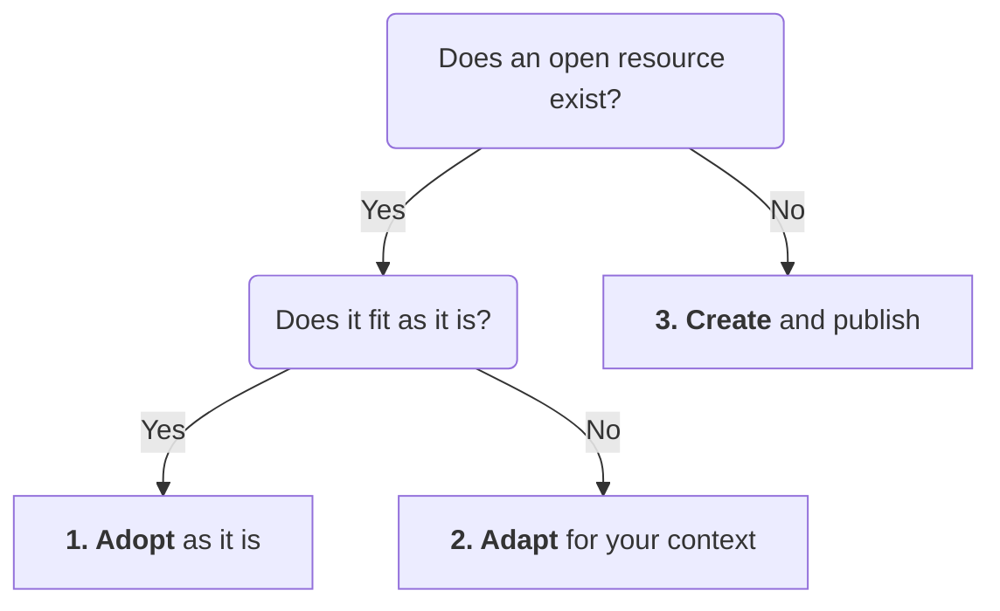

Helios Open Reader includes shortcodes for embedding rich content responsively, with automatic dark/light theme detection where supported.

## iFrame – [raw]`[iframe]`[/raw]

[raw]
```
[iframe url="https://example.com/embed"]
```
[/raw]

Embeds any URL in a responsive 16:9 container. Add a `title` for accessibility (recommended), and optionally set a different ratio:

[raw]
```
[iframe url="https://example.com" title="My embedded content"]
[iframe url="https://example.com" title="My embedded content" ratio="4:3"]
```
[/raw]

## Google Slides – [raw]`[googleslides]`[/raw]

[raw]
```
[googleslides url="https://docs.google.com/presentation/d/..." title="Introduction slides"]
```
[/raw]

Embeds a Google Slides presentation responsively. Paste the "Publish to the web" embed URL. Supports `ratio="4:3"`.

## PDF Viewer – [raw]`[pdf]`[/raw]

[raw]
```
[pdf url="https://example.com/document.pdf" title="Course reading"]
```
[/raw]

Displays a PDF via Google Docs viewer. Default ratio is 16:9. For letter or A4 documents:

[raw]
```
[pdf url="https://example.com/document.pdf" title="Course reading" ratio="portrait"]
```
[/raw]

## H5P Interactive Content – [raw]`[h5p]`[/raw]

Embed via full URL:

[raw]
```
[h5p url="https://h5p.org/h5p/embed/123" title="Interactive quiz"]
```
[/raw]

Or via Content ID (requires **H5P Content Embed Source URL** to be set in plugin settings):

[raw]
```
[h5p id="123" title="Interactive quiz"]
```
[/raw]

## Embedly Cards – [raw]`[embedly]`[/raw]

[raw]
```
[embedly url="https://example.com/article"]
```
[/raw]

Renders an Embedly card with dark mode support. Useful for embedding links to articles, videos, and other web content with rich previews.

> [!TIP]
> All embed shortcodes are responsive by default. Always add a descriptive `title` parameter to iframe-based shortcodes (`[iframe]`, `[googleslides]`, `[pdf]`, `[h5p]`) — this sets the iframe's accessible title for screen readers. The 16:9 ratio works well for video content and slides; use `ratio="portrait"` for PDF documents and `ratio="4:3"` for older slide formats.

## Diagrams – Mermaid

Flowcharts, timelines and other diagrams can be written as text in a code block marked `mermaid`. The Mermaid plugin draws them to match light or dark mode:

~~~markdown

~~~

Which draws:


The `accTitle` and `accDescr` lines give screen readers a title and description, like an image's alt text.

## Math – LaTeX

Math can be written as LaTeX: between single dollar signs within a sentence, or between double dollar signs on their own lines for a block. The LaTeX Math plugin draws it:

~~~markdown
The average of $n$ values is their sum divided by $n$:

$$
\bar{x} = \frac{1}{n} \sum_{i=1}^{n} x_i
$$
~~~

Which draws:

The average of $n$ values is their sum divided by $n$:

$$
\bar{x} = \frac{1}{n} \sum_{i=1}^{n} x_i
$$
