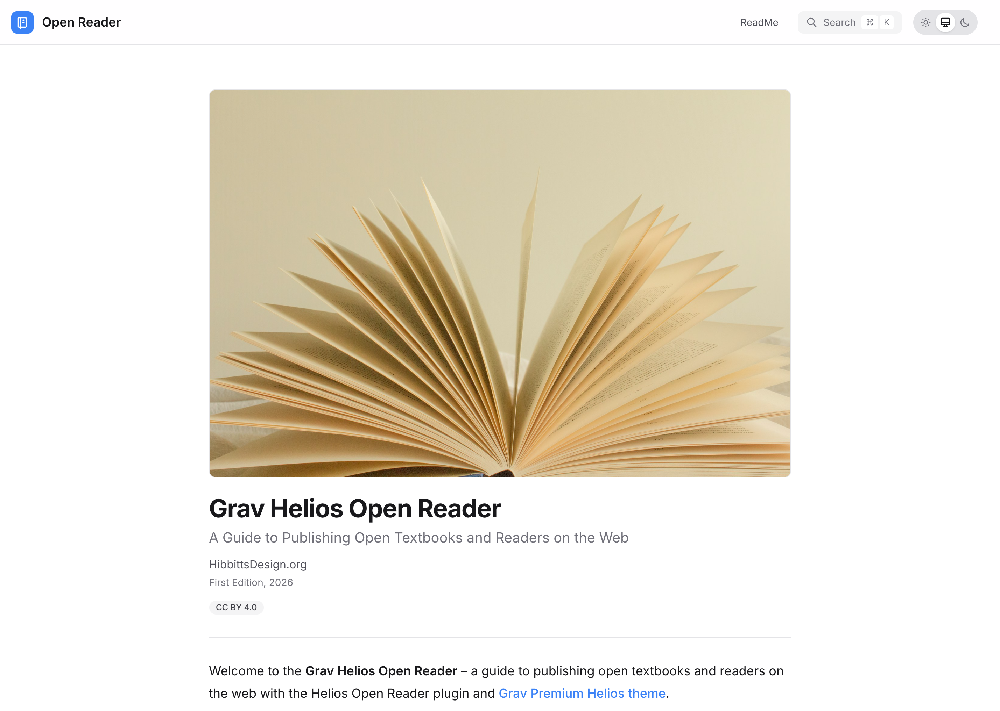
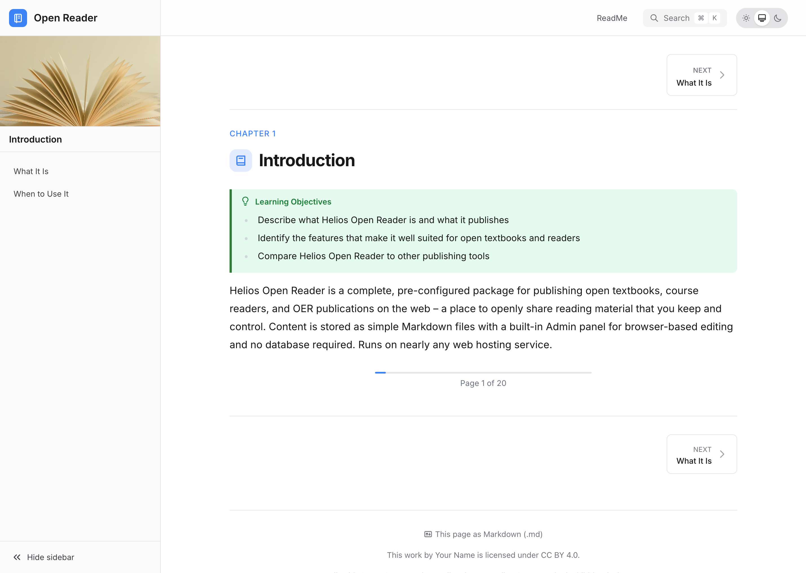
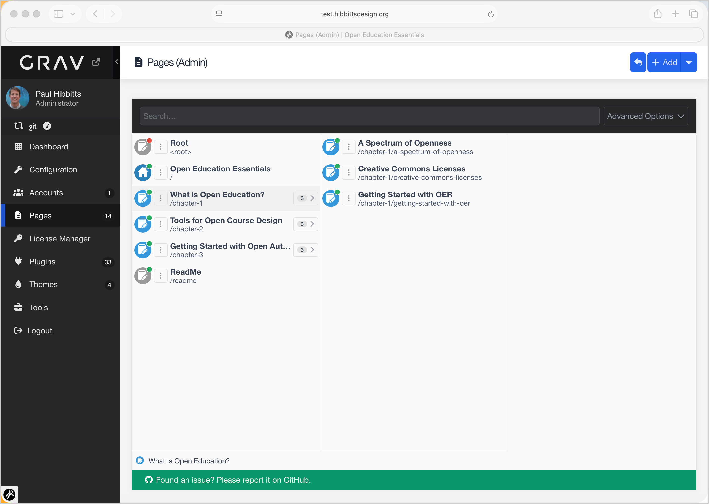
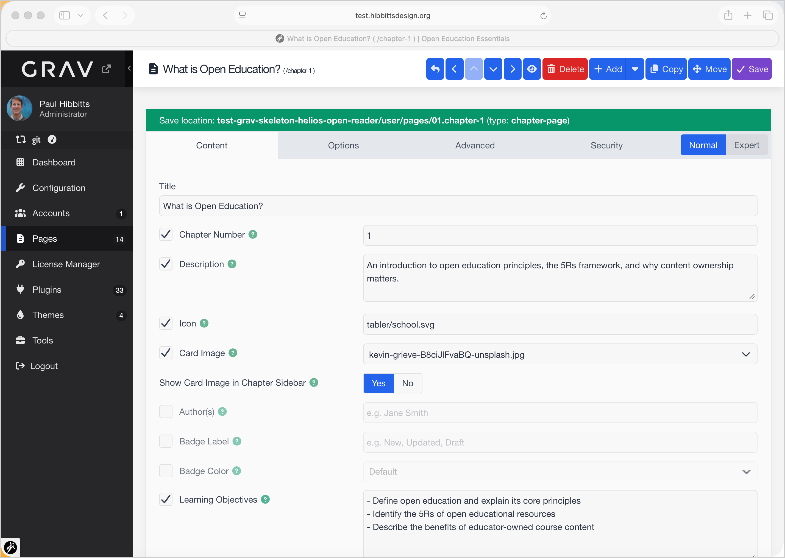

# 📖 Grav Helios Open Reader

### All Screenshots

*Full screenshot gallery for the [Grav Helios Open Reader](../README.md). Click any image to view full size.*

<table>
  <tr>
    <td width="49%">
      <a href="https://raw.githubusercontent.com/hibbitts-design/grav-skeleton-helios-open-reader/refs/heads/main/screenshots/screenshot-1.png">
      <picture>
        <source media="(prefers-color-scheme: dark)" srcset="https://raw.githubusercontent.com/hibbitts-design/grav-skeleton-helios-open-reader/refs/heads/main/screenshots/screenshot-1-dark.png">
        
      </picture>
      </a>
    </td>
    <td width="49%">
      <a href="https://raw.githubusercontent.com/hibbitts-design/grav-skeleton-helios-open-reader/refs/heads/main/screenshots/screenshot-2.png">
      <picture>
        <source media="(prefers-color-scheme: dark)" srcset="https://raw.githubusercontent.com/hibbitts-design/grav-skeleton-helios-open-reader/refs/heads/main/screenshots/screenshot-2-dark.png">
        
      </picture>
      </a>
    </td>
  </tr>
  <tr>
    <td align="center">Open Reader – Publication home</td>
    <td align="center">Open Reader – Chapter page</td>
  </tr>
  <tr><td colspan="2">&nbsp;</td></tr>
  <tr>
    <td width="49%">
      <a href="https://raw.githubusercontent.com/hibbitts-design/grav-skeleton-helios-open-reader/refs/heads/main/screenshots/screenshot-admin-1.png">
      <picture>
        
      </picture>
      </a>
    </td>
    <td width="49%">
      <a href="https://raw.githubusercontent.com/hibbitts-design/grav-skeleton-helios-open-reader/refs/heads/main/screenshots/screenshot-admin-2.png">
      <picture>
        
      </picture>
      </a>
    </td>
  </tr>
  <tr>
    <td align="center">Admin Panel – Pages overview</td>
    <td align="center">Admin Panel – Section page edit</td>
  </tr>
</table>
